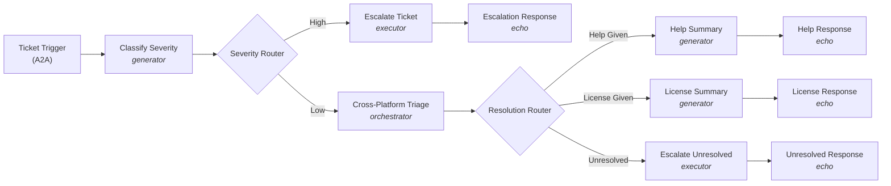

# Canonical Example: IT Help Investigation (GA)

A complete Agent Network V2 (GA, A2A v1.0) project, reproduced **verbatim** from the docs page *Example: Building an IT Investigation Broker* (`af-example-it-investigation-broker`, docs-code-builder `latest`). A runnable copy with mock endpoints is at `github.com/MuleSoft-AI-Chain-Project/example-mule-apps`, path `agent-network-2.0-examples/it-investigation-broker-example`. When in doubt about a field name, value, or indentation, mirror this example exactly.

GA adopts **A2A v1.0**. Agent Broker stays backward-compatible with A2A v0.3 agents via the `a2a_v03` registry branch. That branch is shown below for `helpCenterAgent` and `licenseProcurementAgent`, which haven't migrated.

> The docs narrative mentions GPT-5.4 for orchestration and Gemini 2.5 Flash for summaries, but the published project code uses a single OpenAI `gpt-5-mini` LLM for every node. This file mirrors the code.

## What it does

Triages incoming IT support tickets and produces one of four outcomes:

| Outcome | When | What happens |
|---|---|---|
| Escalation | High-severity ticket | Ticket escalated to on-call team |
| Help Given | Low-severity, answer in knowledge base | Jira updated, user gets summary |
| License Provisioned | Low-severity, licensing issue resolved | License provisioned, Jira updated |
| Unresolved | Low-severity, no automated solution | Ticket escalated to a human agent |



LLM-powered nodes:
- `classifySeverity` — `generator` (pure classification, structured output, no actions/HITL).
- `crossPlatformTriage` — `orchestrator` (coordinates Help Center A2A, License Procurement A2A, Jira MCP toward compound triage goal).
- `helpSummary`, `licenseSummary` — `generator` (one-shot summary).

Deterministic nodes:
- `escalateTicket`, `escalateUnresolved` — `executor` (router-gated escalations).
- `severityRouter`, `resolutionRouter` — `router` (deterministic branching on enum outputs).

## Project structure

```
it-help-network/
  agent-network.yaml
  brokers/
    it-help-investigation.agent
  exchange.json
```

## `agent-network.yaml`

```yaml
agentNetwork: 2.0.0
info:
  label: "IT Help Investigation Agent Network"
  version: v1
registry:
  agents:
    helpCenterAgent:
      info:
        label: Help Center Agent
      metadata:
        platform: Other
        interfaces:
          a2a_v03:
            card:
              name: Help Center Agent
              description: Searches the IT knowledge base for answers to common issues. Returns relevant articles with step-by-step instructions.
              url: ${helpCenterAgent.url}
              protocolVersion: 0.3.0
              version: 1.0.0
              capabilities:
                pushNotifications: false
              defaultInputModes:
                - application/json
                - text/plain
              defaultOutputModes:
                - application/json
                - text/plain
              skills:
                - id: knowledge-search
                  name: Knowledge Base Search
                  description: Search for IT help articles and known solutions.
                  tags:
                    - knowledge-base
                    - it-support
                  examples:
                    - How do I reset my VPN password?
                    - My email is not syncing
                    - How do I set up two-factor authentication?
                  inputModes:
                    - application/json
                    - text/plain
                  outputModes:
                    - application/json
                    - text/plain
    licenseProcurementAgent:
      info:
        label: License Procurement Agent
      metadata:
        platform: Other
        interfaces:
          a2a_v03:
            card:
              name: License Procurement Agent
              description: Checks software license availability and provisions licenses for employees.
              url: ${licenseProcurementAgent.url}
              protocolVersion: 0.3.0
              version: 1.0.0
              capabilities:
                pushNotifications: false
              defaultInputModes:
                - application/json
                - text/plain
              defaultOutputModes:
                - application/json
                - text/plain
              skills:
                - id: license-check
                  name: License Check and Provision
                  description: Check license availability and provision for a user.
                  tags:
                    - licensing
                    - provisioning
                  examples:
                    - Provision a Figma license for jane.doe@company.com
                    - Check if we have available GitHub Enterprise seats
                    - I need access to Jira
                  inputModes:
                    - application/json
                    - text/plain
                  outputModes:
                    - application/json
                    - text/plain
  mcps:
    escalationMcp:
      info:
        label: Escalation MCP Server
      metadata:
        transport:
          kind: streamableHttp
          path: /mcp
    jiraMcp:
      info:
        label: Jira MCP Server
      metadata:
        transport:
          kind: streamableHttp
          path: /mcp
  llms:
    openAiMini:
      info:
        label: GPT Mini
      metadata:
        platform: OpenAI
context:
  connections:
    help_center_agent_connection:
      kind: a2a
      ref:
        name: helpCenterAgent
      url: ${helpCenterAgent.url}
    license_procurement_agent_connection:
      kind: a2a
      ref:
        name: licenseProcurementAgent
      url: ${licenseProcurementAgent.url}
      authentication:
        kind: oauth2-client-credentials
        clientId: ${licenseProcurementAgent.clientId}
        clientSecret: ${licenseProcurementAgent.clientSecret}
        token:
          url: ${licenseProcurementAgent.tokenUrl}
    escalation_mcp_connection:
      kind: mcp
      ref:
        name: escalationMcp
      url: ${escalationMcp.url}
      authentication:
        kind: apiKey
        apiKey: ${escalationMcp.apiKey}
    jira_mcp_connection:
      kind: mcp
      ref:
        name: jiraMcp
      url: ${jiraMcp.url}
      authentication:
        kind: oauth2-obo
        flow: oauth2-token-exchange
        clientId: ${jiraMcp.clientId}
        clientSecret: ${jiraMcp.clientSecret}
        tokenEndpoint: ${jiraMcp.tokenUrl}
    openai_mini_connection:
      kind: llm
      ref:
        name: openAiMini
      url: https://api.openai.com/v1
      authentication:
        kind: apiKey
        apiKey: ${openai.apiKey}
brokers:
  it_help_investigation:
    kind: AgentScript
    implementation: ./brokers/it-help-investigation.agent
    interfaces:
      a2a:
        card:
          name: IT Help Desk Broker
          description: Triages IT support tickets, escalates critical issues, and resolves common problems through cross-platform investigation.
          version: 1.0.0
          capabilities:
            streaming: false
            pushNotifications: false   # the docs example says true; CLI 1.5.0 build rejects true (error 1035)
          defaultInputModes:
            - text/plain
          defaultOutputModes:
            - text/plain
          skills:
            - id: ticket-triage
              name: IT Ticket Triage
              description: Classifies and resolves IT support tickets.
              tags:
                - it-support
                - help-desk
```

## `exchange.json`

```json
{
  "main": "agent-network.yaml",
  "name": "IT Help Investigation Agent Network",
  "classifier": "agentic-network",
  "groupId": "${organizationId}",
  "assetId": "it-help-investigation-network",
  "version": "1.0.0",
  "descriptorVersion": "1.0.0",
  "apiVersion": "v1.0",
  "description": "Triages IT support tickets, escalates critical issues, and resolves common problems through cross-platform investigation with Help Center and License Procurement agents.",
  "tags": [],
  "dependencies": [],
  "metadata": {
    "variables": {
      "helpCenterAgent": {
        "url": {
          "description": "Help Center Agent A2A URL",
          "default": "",
          "secret": false
        }
      },
      "licenseProcurementAgent": {
        "url": {
          "description": "License Procurement Agent A2A URL",
          "default": "",
          "secret": false
        },
        "tokenUrl": {
          "description": "OAuth2 token endpoint for the License Procurement agent (client credentials grant)",
          "default": "",
          "secret": false
        },
        "clientId": {
          "description": "OAuth2 client ID the broker presents to the License Procurement agent",
          "default": "",
          "secret": false
        },
        "clientSecret": {
          "description": "OAuth2 client secret -- inject at deploy time via --property, never commit a default value",
          "default": "",
          "secret": true
        }
      },
      "escalationMcp": {
        "url": {
          "description": "Escalation MCP Server URL",
          "default": "",
          "secret": false
        },
        "apiKey": {
          "description": "API key for the Escalation MCP server -- inject at deploy time, never commit a default value",
          "default": "",
          "secret": true
        }
      },
      "jiraMcp": {
        "url": {
          "description": "Jira MCP Server URL (called on-behalf-of the inbound user)",
          "default": "",
          "secret": false
        },
        "tokenUrl": {
          "description": "OAuth2 token endpoint Jira accepts for the OBO token exchange",
          "default": "",
          "secret": false
        },
        "clientId": {
          "description": "OAuth2 client ID the broker uses to perform the OBO exchange with Jira",
          "default": "",
          "secret": false
        },
        "clientSecret": {
          "description": "OAuth2 client secret for the Jira OBO exchange -- inject at deploy time, never commit a default value",
          "default": "",
          "secret": true
        }
      },
      "openai": {
        "apiKey": {
          "description": "OpenAI API key -- inject at deploy time, never commit a default value",
          "default": "",
          "secret": true
        }
      }
    }
  }
}
```

Real values for the empty `"default": ""` variables are injected at deploy time, e.g. `--property openai.apiKey:$OPENAI_API_KEY --property helpCenterAgent.url:https://…/`.

## `brokers/it-help-investigation.agent`

```text
# @dialect: AGENTFABRIC=1.0
system:
  instructions: "You are an IT Help Desk agent. You triage incoming support tickets, classify their severity, and either escalate, investigate, or request more information."

config:
  agent_name: "it-help-investigation"
  default_llm: @llm.openai_mini

llm:
  openai_mini:
    target: "llm://openai_mini_connection"
    kind: "OpenAI"
    model: "gpt-5-mini"

# -- ACTION DEFINITIONS -------------------------------------------------------
actions:
  help_center_agent:
    target: "a2a://help_center_agent_connection"
    kind: "a2a:send_message"

  license_procurement_agent:
    target: "a2a://license_procurement_agent_connection"
    kind: "a2a:send_message"

  escalate:
    target: "mcp://escalation_mcp_connection"
    kind: "mcp:tool"
    tool_name: "escalate"

  updateIssue:
    target: "mcp://jira_mcp_connection"
    kind: "mcp:tool"
    tool_name: "updateIssue"

# -- TRIGGER -------------------------------------------------------------------
trigger ticketTrigger:
  kind: "a2a"
  target: "brokers://it_help_investigation/a2a"
  on_message: ->
    transition to @generator.classifySeverity

# -- SEVERITY CLASSIFICATION ---------------------------------------------------
generator classifySeverity:
  description: "Classifies the severity of the support ticket."
  label: "Classify Severity"
  llm: @llm.openai_mini
  system:
    instructions: |
      Classify the severity of the incoming IT support ticket and extract the Jira ticket ID.

      Classify as HIGH:
      - System outages affecting multiple users (e.g. "VPN is down for the entire office", "Nobody in Building 3 can connect")
      - Security incidents involving unauthorized access or suspicious activity (e.g. "unauthorized login attempts from an IP in another country")
      - Any blocking issue impacting a team, building, or department

      Classify as LOW:
      - Password resets or connectivity help (e.g. "I forgot my VPN password")
      - Software license or access requests (e.g. "rate limited on my Figma MCP server", "I need access to Tableau")
      - Single-user issues with a clear description

      The ticket_id must always be a string value.
      If no Jira ticket ID is provided in the input, default ticket_id to "JIRA001".
  prompt: ->
    | {!@request.payload.message.parts[0].text}
  outputs:
    properties:
      ticket_id:
        type: "string"
        description: "The Jira ticket ID extracted from the input (e.g. '001' from 'Jira ticket ID 001')"
      severity:
        type: "string"
        description: "The severity level"
        enum:
          - "high"
          - "low"
      reason:
        type: "string"
        description: "Brief explanation of the classification"
  on_exit: ->
    transition to @router.severityRouter

# -- SEVERITY ROUTING ----------------------------------------------------------
router severityRouter:
  description: "Routes based on the classified severity."
  routes:
    - target: @executor.escalateTicket
      when: @generator.classifySeverity.output.severity == "high"
      label: "High"
  otherwise:
    target: @orchestrator.crossPlatformTriage

# -- HIGH: ESCALATION ---------------------------------------------------------
executor escalateTicket:
  description: "Escalates the ticket using the Escalation MCP tool."
  do: ->
    run @actions.escalate
  on_exit: ->
    transition to @echo.escalationResponse

echo escalationResponse:
  kind: "a2a:status_update_event"
  state: "TASK_STATE_COMPLETED"
  message: a2a.message({messageId: uuid(), parts: [a2a.textPart("Ticket " + @generator.classifySeverity.output.ticket_id + " has been escalated to the on-call team due to high severity: " + @generator.classifySeverity.output.reason)]})

# -- LOW: CROSS-PLATFORM TRIAGE -----------------------------------------------
orchestrator crossPlatformTriage:
  description: "Investigates the ticket using Help Center and License Procurement agents."
  label: "Cross-Platform Triage"
  llm: @llm.openai_mini
  system:
    instructions: |
      Investigate this low-severity IT support ticket.
      Step 1: Search the Help Center agent for relevant articles or known solutions.
      Step 2: If the issue involves software licensing, check with the License Procurement agent.
      Step 3: Update the Jira ticket with your findings and resolution.
      If you found an answer from the Help Center, set resolution to "help_given".
      If you resolved a licensing issue, set resolution to "license_given".
      If you could not find a solution or the issue requires human intervention, set resolution to "unresolved".
      Always update the Jira ticket with resolution notes.
  reasoning:
    instructions: ->
      | {!@request.payload.message.parts[0].text}
    actions:
      search_help: @actions.help_center_agent
      check_license: @actions.license_procurement_agent
      update_ticket: @actions.updateIssue
        with http_headers = {"Authorization": @request.headers["Authorization"]}
    outputs:
      properties:
        resolution:
          type: "string"
          description: "The resolution type"
          enum:
            - "help_given"
            - "license_given"
            - "unresolved"
        summary:
          type: "string"
          description: "Summary of the resolution and actions taken"
  on_exit: ->
    transition to @router.resolutionRouter

# -- RESOLUTION ROUTING --------------------------------------------------------
router resolutionRouter:
  description: "Routes based on the resolution type from triage."
  routes:
    - target: @generator.licenseSummary
      when: @orchestrator.crossPlatformTriage.output.resolution == "license_given"
      label: "License Given"
    - target: @executor.escalateUnresolved
      when: @orchestrator.crossPlatformTriage.output.resolution == "unresolved"
      label: "Unresolved"
  otherwise:
    target: @generator.helpSummary

# -- HELP GIVEN PATH ----------------------------------------------------------
generator helpSummary:
  description: "Generates a summary of the help resolution."
  system:
    instructions: "You generate clear, friendly summaries of IT help desk resolutions."
  prompt: ->
    | Generate a resolution summary for the user. Original request: {!@request.payload.message.parts[0].text}. Resolution and actions taken: {!@orchestrator.crossPlatformTriage.output.summary}
  on_exit: ->
    transition to @echo.helpResponse

echo helpResponse:
  kind: "a2a:status_update_event"
  state: "TASK_STATE_COMPLETED"
  message: a2a.message({messageId: uuid(), parts: [a2a.textPart(@generator.helpSummary.output)]})

# -- LICENSE GIVEN PATH --------------------------------------------------------
generator licenseSummary:
  description: "Generates a summary of the license provisioning."
  system:
    instructions: "You generate clear, friendly summaries of license provisioning actions."
  prompt: ->
    | Generate a license provisioning summary for the user. Original request: {!@request.payload.message.parts[0].text}. Resolution and actions taken: {!@orchestrator.crossPlatformTriage.output.summary}
  on_exit: ->
    transition to @echo.licenseResponse

echo licenseResponse:
  kind: "a2a:status_update_event"
  state: "TASK_STATE_COMPLETED"
  message: a2a.message({messageId: uuid(), parts: [a2a.textPart(@generator.licenseSummary.output)]})

# -- UNRESOLVED PATH -----------------------------------------------------------
executor escalateUnresolved:
  description: "Escalates an unresolved low-severity ticket to a human agent."
  do: ->
    run @actions.escalate
  on_exit: ->
    transition to @echo.unresolvedResponse

echo unresolvedResponse:
  kind: "a2a:status_update_event"
  state: "TASK_STATE_COMPLETED"
  message: a2a.message({messageId: uuid(), parts: [a2a.textPart("Ticket " + @generator.classifySeverity.output.ticket_id + " could not be resolved automatically and has been escalated to a human agent. Summary: " + @orchestrator.crossPlatformTriage.output.summary)]})
```

## Non-obvious patterns this example confirms

These are the things the published docs don't make obvious. Read the docs for everything else.

0. **IDs and naming.**
   - **Broker IDs** (`brokers.<id>`): use lowercase snake_case, e.g. `it_help_investigation`. The docs require it even though the schema is looser.
   - **Connection IDs** (`context.connections.<id>`): no pattern is documented. Follow the docs' snake_case convention (`help_center_agent_connection`).
   - **Registry asset IDs** (agents/mcps/llms): must match `^[a-zA-Z_][a-zA-Z0-9_.-]*$`. camelCase (`helpCenterAgent`) and kebab-case both work. Each becomes an Exchange asset name that must be unique across the org (error 2006).
   - **Hard rule:** `.agent` targets (`a2a://`, `mcp://`, `llm://`, `brokers://`) must match the YAML key **exactly** (a trigger mismatch is error 1021).
   - **Filename:** the `.agent` file's name is independent of the broker ID; kebab-case is fine (`it-help-investigation.agent`).
1. **`info.version: v1`** is valid. Non-semver strings are accepted.
2. **`exchange.json`**: this example omits `organizationId` and templates `"groupId": "${organizationId}"`. The YAML reference's own samples include a literal `organizationId`, so either form appears in the docs. `groupId` is the business group that owns the network; change it to publish to another business group. `assetId` is the network's own asset (`it-help-investigation-network`). `apiVersion` is the Exchange **version group**: Exchange auto-increments the semantic version, and renaming the group bumps the major version. `dependencies: []` is fine when all assets are inline. Every `${…}` placeholder in the YAML has a matching `metadata.variables` entry. Secrets carry `"secret": true` with `"default": ""`, and real values arrive via `--property`.
3. **A2A v1.0 cards have no top-level `url` or `protocolVersion`.** Those live in `supportedInterfaces[]`, and the schema rejects them at the top level. The broker card here omits both because the broker is the endpoint and serves itself. The **`a2a_v03`** branch keeps the legacy flat shape with `url` (here a `${…url}` variable) and `protocolVersion: 0.3.0`.
4. **Registry agents use `metadata.interfaces.<branch>.card`**, where `branch` is `a2a` (A2A v1.0), `a2a_v03` (legacy), or `other`. The Beta-era `metadata.protocol` + flat `metadata.card` shape no longer applies.
5. **Auth on connections.** `authentication` is **required** for `kind: llm` and optional for `a2a`/`mcp`. This example shows the three common kinds:
   - `apiKey` (camelCase): `escalation_mcp_connection` and the LLM.
   - `oauth2-client-credentials`: `clientId`, `clientSecret`, `token.url` (`license_procurement_agent_connection`).
   - `oauth2-obo`: `flow: oauth2-token-exchange`, `clientId`, `clientSecret`, `tokenEndpoint` (`jira_mcp_connection`), which calls Jira on behalf of the inbound user.
6. **MCP actions omit `inputs:`**, and the runtime discovers tool arguments. Declared inputs are *"not exhaustive"*. Declare `inputs:` only when you need `with` to fix or default a value, and never invent parameter names.
7. **A2A actions** in `reasoning.actions` are bare references (no `with message =`).
8. **Forwarding the caller's token with `http_headers`.** `update_ticket: @actions.updateIssue` is followed by `with http_headers = {"Authorization": @request.headers["Authorization"]}`. `http_headers` is the one implicit parameter on both MCP and A2A actions. Here it passes the inbound user's `Authorization` header so the OBO exchange has a subject token.
9. **`outputs:` placement.** The generator declares `outputs` at node top level (`classifySeverity`). The orchestrator declares them inside `reasoning:` (`crossPlatformTriage`). For subagent/orchestrator nodes both placements are valid; this skill's convention is `reasoning.outputs`, with one place per node.
10. **Echo nodes use A2A v1.0 update events**: `kind: "a2a:status_update_event"` (state + message) or `kind: "a2a:artifact_update_event"` (artifact + append/lastChunk). State values are `TASK_STATE_*` constants (`TASK_STATE_COMPLETED`, `TASK_STATE_FAILED`, etc.).
11. **One echo per terminal path.** This example has four echo nodes. Inside `a2a.message()` / `a2a.textPart()`, references are direct (`@generator.classifySeverity.output.ticket_id + " escalated"`). The `{!@...}` template form does NOT apply inside echo helpers.
12. **Dialect `# @dialect: AGENTFABRIC=1.0`** pins the file to GA dialect 1.0.
13. **`policies` shape (GA).** When used, `policies` is an object with `inbound` and `outbound` arrays, not a flat list of policy IDs.
14. **`supportedInterfaces`: one object per transport binding.** A v1.0 card advertises its endpoint(s) via `card.supportedInterfaces`, an array.
    - Each entry is `{url, protocolBinding, protocolVersion, tenant}`.
    - `protocolBinding` is one of `JSONRPC`, `GRPC`, `HTTP+JSON` (literal `+`).
    - `protocolVersion` is a **quoted string**.
    - To support both HTTP+JSON and JSONRPC, write exactly two objects. Don't retry or improvise the key names:

    ```yaml
    supportedInterfaces:
      - url: http://localhost:8001/itHelpInvestigationBroker/
        protocolBinding: HTTP+JSON
        protocolVersion: "1.0"
      - url: http://localhost:8001/itHelpInvestigationBroker/
        protocolBinding: JSONRPC
        protocolVersion: "1.0"
    ```

    `protocolVersion` must match the agent's actual runtime A2A version. A mismatch makes the platform apply the wrong Agent Card policy and skip the egress-proxy URL rewrite, so the call fails at runtime with `401 Unauthorized`, not a version error.
15. **Broker cards must set `pushNotifications: false`.** The docs page still shows `pushNotifications: true` on this broker, and the YAML reference allows `true` or `false`. But CLI 1.5.0 `project build` fails with error 1035 `pushNotificationNotSupported`: *"Broker '<id>' declares 'capabilities.pushNotifications: true' in 'interfaces.a2a.card', but push notifications are not supported. Set it to false and try again."* This example uses `false`. The check covers only broker cards (`brokers.<id>.interfaces.a2a.card`), not registry agent cards.
