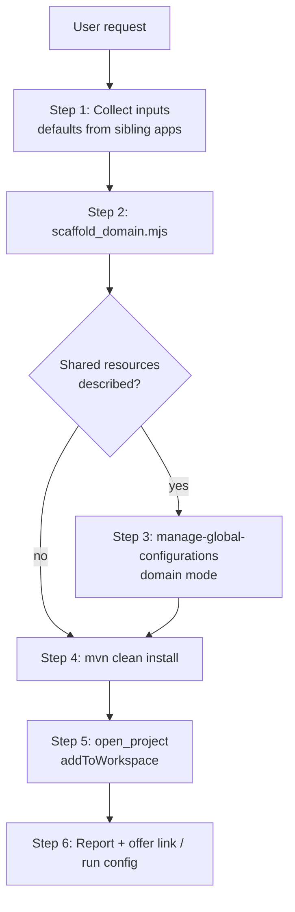

# Create Mule Domain Project

Create a Mule 4 domain project that Anypoint Code Builder recognizes as a first-class **domain** project (pom `<packaging>mule-domain</packaging>`), optionally seeded with the shared resources the user describes in natural language.

**What you'll build:** A domain project (`pom.xml`, `mule-artifact.json`, `mule-domain-config.xml`, `domain.properties`) installed in `~/.m2` and added to the VS Code workspace, ready for applications to link to it.

## When to Use This Skill

**Use this skill when users request:**

- "Create a domain project" / "New Mule domain called shared-services"
- "I want my apps to share one HTTP listener on port 8081"
- "Set up a domain with a shared database connection pool and a TLS context"
- "Create a domain for my orders and billing apps"

**Do not use it for:**

- Creating a Mule application → skill build-mule-integration
- Adding, editing, or removing a shared resource in an existing domain → skill manage-global-configurations (domain mode)
- Linking or unlinking an application to a domain → skill link-mule-domain
- Running a domain with its applications → skill create-mule-run-config

## Prerequisites

- Node.js 18+ (the bundled script is zero-dependency ESM).
- Maven 3.9.x, used to `mvn install` the domain so that linked applications and the run configuration can resolve it from `~/.m2`.
- A workspace folder to create the domain in. Usually this is the same parent folder (or multi-root workspace) as the applications that will use it.

**Platform constraint:** domains only run on customer-hosted Mule Runtime (standalone server, hybrid, or Runtime Fabric on self-managed infrastructure). CloudHub and CloudHub 2.0 do **not** support domains. Tell the user this whenever their apps deploy to CloudHub.

## Bundled scripts

Invoke scripts by the absolute path of this skill's directory (the directory containing this `SKILL.md`). The examples below write `<skill-dir>/scripts/...`. Do not use relative `../` paths.

| Script | Purpose | Output |
| --- | --- | --- |
| `scripts/scaffold_domain.mjs` | Writes the domain project: `pom.xml` (packaging `mule-domain`, `mule-maven-plugin` 4.10.3, the Exchange and MuleSoft repositories used by ACB), `mule-artifact.json` (`minMuleVersion` = runtime `x.y.0`, `javaSpecificationVersions`), `src/main/mule/mule-domain-config.xml` (root `<domain:mule-domain>` with `<configuration-properties file="domain.properties">`), `src/main/resources/domain.properties`, an empty `src/test/munit` folder (without it, `mvn install` fails in `generate-test-sources` once the domain has a connector dependency), and `.vscode/settings.json`. The name is converted to kebab-case, which becomes both the folder name and the artifactId. Refuses to overwrite an existing folder. | stdout JSON `{projectDir, artifactId, groupId, version, runtime, java, files[]}`. Exit 0 when written, 1 on bad input or an existing folder |

```
node <skill-dir>/scripts/scaffold_domain.mjs <parent-dir> <domain-name> \
  [--group-id com.mycompany] [--version 1.0.0-SNAPSHOT] \
  [--runtime 4.9.0] [--java 17] \
  [--control-plane <host>] [--exchange-url <maven-facade-url>]
```

The logic lives in `lib/domain-scaffold.mjs`; tests are in `lib/domain-scaffold.test.mjs` (`node --test`).

## Workflow

### Execution paths

- **Create an empty domain**: Steps 1, 2, 4, 5, 6
  - When: User asks for a domain project without describing any shared resources
  - You'll need: `domainName`, `parentDir`

- **Create a domain with shared resources**: Steps 1, 2, 3, 4, 5, 6
  - When: User describes what the domain should share (HTTP listener, DB pool, JMS, TLS context, object store)
  - You'll need: `domainName`, `parentDir`, `sharedResources`

### Architecture



### Step 1: Collect inputs

Read what the user already said, and ask (with `AskUserQuestion`) only for what is missing:

| Input | Default | Notes |
| --- | --- | --- |
| Domain name | none (required) | At least 3 characters. Converted to kebab-case (`Shared Services` → `shared-services`). |
| Parent folder | Workspace root | The folder that contains the user's Mule apps. It may not exist yet: the script creates missing parent folders, so do not stop or ask. |
| groupId | The sibling apps' `groupId`, else `com.mycompany` | Linked apps reference the domain by this groupId. |
| Mule Runtime | The sibling apps' highest `app.runtime`, else `4.9.0` | **Apps inherit the domain's runtime when they are linked.** Pick a version every app can run on. |
| Java | The sibling apps' `javaSpecificationVersions`, else `17` | Apps inherit this too. |
| Exchange repository | Copy the `anypoint-exchange-v3` URL from a sibling app's `pom.xml` (`--exchange-url`); otherwise pass the Anypoint control-plane host the user signs in to (`--control-plane eu1.anypoint.mulesoft.com`, default `anypoint.mulesoft.com`); the script builds `https://maven.<host>/api/v3/maven`, so any region works | Keeps the domain resolving connectors from the same Exchange as the apps. |

To read the sibling defaults, run the scan from skill link-mule-domain (`node <link-mule-domain-dir>/scripts/scan_workspace.mjs <workspace-root>`, where `<link-mule-domain-dir>` is the sibling `link-mule-domain` folder next to this skill's directory), or read the sibling `pom.xml` and `mule-artifact.json` files directly.

**No sibling apps:** an app the user names might not exist yet (for example, "a domain for my orders app" before `orders-app` is created), or the parent folder might contain no apps. Either way, do not stop and do not ask for the groupId, runtime, or Java. Use the defaults above and list them in the Step 6 summary. Ask only for the control-plane host (the address of the Anypoint Platform they sign in to), and only if the user hasn't given it.

### Step 2: Scaffold

```bash
node <skill-dir>/scripts/scaffold_domain.mjs "<parent-dir>" "<domain-name>" \
  --group-id "<groupId>" --runtime "<runtime>" --java "<java>" --exchange-url "<url>"
```

If the script exits 1 because the folder exists, **stop** and ask the user for another name. Never delete or overwrite the existing folder.

### Step 3: Add shared resources (when the user described any)

Turn the user's natural-language description into shared resources by following skill manage-global-configurations in **domain mode**. That skill detects `<packaging>mule-domain</packaging>` and then:

- writes global elements into `src/main/mule/mule-domain-config.xml`, inside the `<domain:mule-domain>` root;
- writes `${placeholders}` for every environment-specific value (host, port, user, password, keystore path), with entries in `src/main/resources/domain.properties`;
- adds the connector dependencies to the **domain's** `pom.xml`.

Typical mappings:

| User says | Shared resource |
| --- | --- |
| "share an HTTP listener on 8081" | `http:listener-config` with `port="${http.port}"`, `http.port=8081` |
| "shared HTTPS listener" | `http:listener-config` with `protocol="HTTPS"` + `tls:context` with keystore placeholders |
| "shared DB pool" / "MySQL connection" | `db:config` with `db:my-sql-connection` (+ the JDBC driver as a domain dependency and `<sharedLibraries>` entry) and `db.*` placeholders |
| "shared JMS / ActiveMQ connection" | `jms:config` with `jms:active-mq-connection` and `jms.*` placeholders |
| "shared TLS context" | `tls:context` with `tls:key-store` / `tls:trust-store` placeholders |
| "shared object store" | `os:object-store` |

**Domains hold only shared global elements.** Do not create `<flow>`, `<sub-flow>`, or error handlers that flows use in a domain. Flows belong to the applications.

### Step 4: Build and install

```bash
cd "<projectDir>" && mvn clean install -DskipTests
```

`install` puts `<artifactId>-<version>-mule-domain.jar` into `~/.m2`. Linked applications compile against that jar, and the run configuration deploys it. If the build fails with a 401 against `anypoint-exchange-v3`, the Anypoint credentials in `~/.m2/settings.xml` are missing or expired. Tell the user, and do not retry blindly.

### Step 5: Add the domain to the workspace

ACB recognizes the domain only after it is in the open VS Code workspace. When the build succeeds, call the `open_project` tool:

```typescript
{
  "projectPath": "<projectDir>",
  "addToWorkspace": true,
  "newWindow": false
}
```

If `open_project` is not available, run `code --add "<projectDir>"`. If both fail, carry on to Step 6 and tell the user to add the folder with **File → Add Folder to Workspace**.

If the window held only one folder before, adding the domain turns it into an unsaved (in-memory) multi-root workspace. A multi-project run configuration needs a saved workspace, so ask the user to save it with **File → Save Workspace As…** before creating one.

### Step 6: Report and offer next steps

Summarize:

- the project folder;
- the GAV (`groupId:artifactId:version`);
- the runtime and Java versions;
- the shared resources created, with the properties each one needs;
- that the domain is not deployable to CloudHub.

Then offer:

1. To link applications to the domain (skill link-mule-domain).
2. To create a run configuration that starts the domain with its applications (skill create-mule-run-config).

## Best Practices

- **Skip-if-provided.** Extract the domain name, parent folder, groupId, runtime, Java, control plane, and shared resources from the user's request before asking anything. Ask only for what is missing or ambiguous. "Create a domain called shared-services with a shared HTTP listener on 8081" needs no questions when sibling apps supply the remaining defaults.
- **Pick the runtime for every app.** Linked apps inherit the domain's runtime and Java version, so choose the highest version all of them can run on.
- **Never overwrite.** If the target folder exists, ask for another name. Never delete it.
- **Shared global elements only.** Domains never contain flows, sub-flows, or flow-bound error handlers.
- **Placeholders for environment values.** Hosts, ports, users, passwords, and keystore paths go to `domain.properties` as `${placeholders}`.
- **Install before linking.** Apps and run configurations resolve the domain from `~/.m2`, so always finish Step 4 before offering skill link-mule-domain.

## Troubleshooting

| Symptom | Cause / fix |
| --- | --- |
| `target folder already exists` | Choose another name. The script never overwrites. |
| `domain name must have at least 3 characters` | Same rule as the ACB "Create Mule Domain Project" command. |
| ACB doesn't show the project as a domain | Make sure the folder is in the workspace (Step 5) and that `pom.xml` has `<packaging>mule-domain</packaging>`. Then reload the window. |
| `mvn install` 401 Unauthorized on `anypoint-exchange-v3` | Refresh the Anypoint credentials in `~/.m2/settings.xml` (or sign in again in ACB), then rebuild. |
| User wants to deploy to CloudHub | Domains aren't supported there. Keep the shared configs in each app instead, or use skill manage-global-configurations to consolidate them per app. |

## Related Skills

- **skill manage-global-configurations**: Add, edit, or remove shared resources in the domain (domain mode)
- **skill link-mule-domain**: Reference the domain from applications, or unlink and inline its configs
- **skill create-mule-run-config**: Run or debug the domain together with its applications
- **skill build-mule-integration**: Build the applications that use the domain
