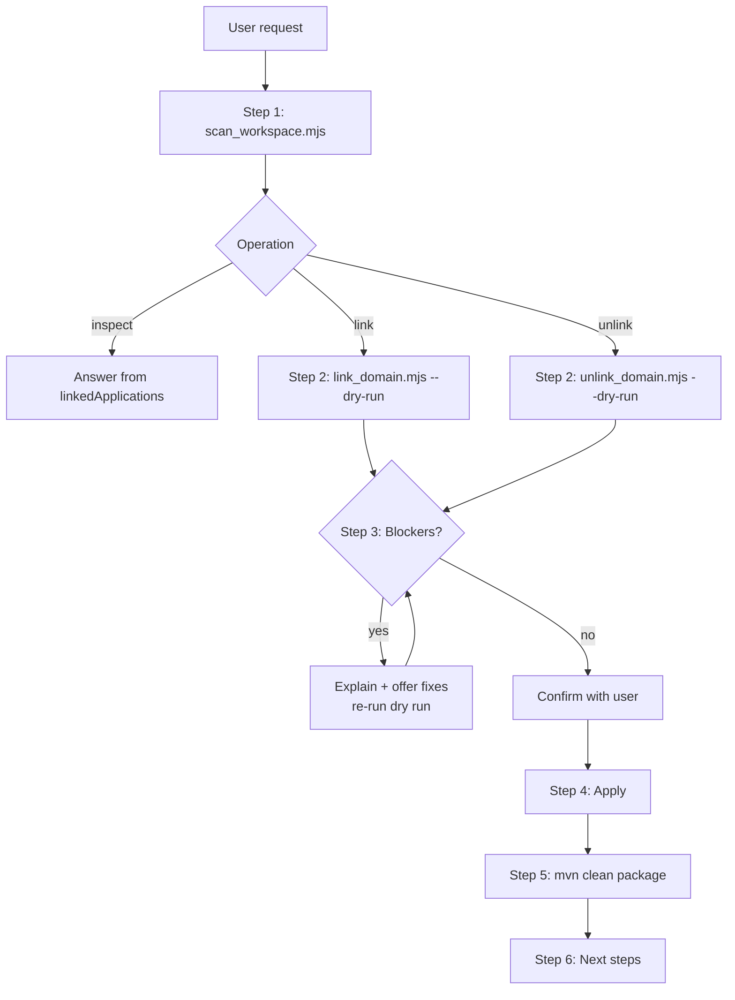

# Link / Unlink a Mule Domain

Link a Mule application to a Mule domain project so that it uses the domain's shared resources. Or unlink it and inline the shared configuration it still needs. Both operations are planned first (a dry run), shown to the user, and applied only after the user confirms.

**What you'll build:** An application whose `pom.xml` and `mule-artifact.json` match the domain (linked), or a standalone application with every shared config it uses inlined into `global-configs.xml` (unlinked). Either way, the app builds with `mvn clean package`.

## When to Use This Skill

**Link:**

- "Link orders-app to shared-domain"
- "Make my apps use the shared HTTP listener from the domain"
- "Add the domain dependency to billing-app"
- "Switch this app to the new domain version"

**Unlink:**

- "Remove the domain from orders-app"
- "Make this app standalone again"
- "Detach billing-app from shared-domain but keep it working"

**Inspect:**

- "Which apps use shared-domain?"
- "Is my app's domain available?"

Not for:

- Creating the domain → skill create-mule-domain-project
- Changing what the domain shares → skill manage-global-configurations
- Running or debugging → skill create-mule-run-config

## Prerequisites

- Node.js 18+ (the scripts are zero-dependency ESM).
- Maven 3.9.x for the verification build.
- The application project, and either the domain project open in the workspace or the domain installed in `~/.m2` (`<artifactId>-<version>-mule-domain.jar`).

## Bundled scripts

Invoke scripts by the absolute path of this skill's directory (the directory containing this `SKILL.md`), shown as `<skill-dir>` below. Every script prints JSON on stdout.

| Script | Purpose | Exit codes |
| --- | --- | --- |
| `scripts/scan_workspace.mjs <root>...` | Lists every Mule domain and application under the roots (depth 0–2). For each **domain**, it reports its GAV, runtime, Java, whether it is installed in `~/.m2`, its shared global elements, and its linked applications. For each **application**, it reports its linked domain, with `domain.status` = `none` \| `workspace` \| `installed` \| `version-mismatch` \| `missing` (the same statuses ACB's domain link report uses). | 0 / 1 bad args |
| `scripts/link_domain.mjs <app-dir> <domain-dir> [--workspace <root>]... [--dry-run]` | Plans and applies a link, with the same edits ACB's *Project Properties → Domain* makes. See "What linking changes" below. `<domain-dir>` can be the domain project or an extracted domain jar. | 0 linked / valid · 1 error · 2 blockers (nothing written) |
| `scripts/unlink_domain.mjs <app-dir> [--domain-dir <dir>] [--workspace <root>]... [--dry-run] [--force]` | Plans and applies an unlink with inlining. See "What unlinking changes" below. Without `--domain-dir`, the domain is located among the `--workspace` projects by groupId:artifactId. | 0 unlinked / valid · 1 error or domain sources not found · 2 blockers (nothing written unless `--force`) |

The logic lives in `lib/` (`domain-link.mjs`, `mule-project.mjs`, `mule-xml.mjs`, `properties.mjs`, `workspace.mjs`). The tests are in `lib/domain-link.test.mjs` (`node --test`). XML and pom edits are text-based and keep the user's formatting and comments.

### What linking changes

- **`pom.xml`**: removes any existing `mule-domain` dependency, then adds `<dependency>` with `<classifier>mule-domain</classifier><scope>provided</scope>` for the domain's GAV. Each connector that both the app and the domain declare becomes `provided` at the domain's version. When the app's version is a `${property}`, the property is updated instead. When the app moves from another domain (or another version of it), connectors that the previous domain supplied and the new one doesn't go back to compile scope; the previous domain's pom is read from the workspace or `~/.m2`. Other `provided` plugins, such as `mule-api-gateway`, are never changed. `app.runtime` is set to the domain's runtime.
- **`mule-artifact.json`**: `minMuleVersion` and `javaSpecificationVersions` are aligned with the domain. All other keys are kept. Mule has no `domain` key in `mule-artifact.json`; the runtime finds the domain through the pom dependency.
- **Cross-project validation** (`references` in the plan):
  - `resolvedByDomain`: app references that the domain satisfies.
  - `dangling`: references that neither the app nor the domain defines. These fail at deploy.
  - `shadowed`: app globals that have the same name as a domain global. The app's definition wins, so the domain's is unused.
- **Warnings** for:
  - app listeners that bind the same port as a domain listener;
  - domain placeholders the domain does not define;
  - a CloudHub deployment in the app pom (not supported with domains).
- **Blockers**:
  - the "app" is itself a domain (a domain cannot link to another domain);
  - the target is not a `mule-domain` project;
  - the domain's runtime or Java version is invalid.

### What unlinking changes

- **Inlining.** Every domain global element the app still references is copied into `src/main/mule/global-configs.xml`, transitively (a listener pulls in its `tlsContext`, and so on). Elements are copied verbatim, so all values and names stay the same and the app's `config-ref`s keep resolving. The file is created if it doesn't exist, and the namespaces and schema locations it needs are added.
- **Placeholders.**
  - Values from `domain.properties` go to `src/main/resources/<domain-artifactId>.properties`, registered through `<configuration-properties>`.
  - Required `<global-property>` and `<secure-properties:config>` elements are inlined as well.
  - Referenced resource files (keystores, truststores, certificates) are copied.
- **`pom.xml`.**
  - The domain dependency is removed.
  - `provided` connectors go back to compile scope, and connectors only the domain declared are added (ACB's restore behavior).
  - The domain's `<sharedLibraries>` (for example, JDBC drivers) are added to the app's `mule-maven-plugin` configuration.
- **Unused shared configs** are listed in `unused` and are **not** copied.
- **Blockers** (configs that cannot be inlined safely):
  - an inlined element references a name the app also defines, so it would bind to the wrong element;
  - an element uses `${domain}` / `${fullDomain}`;
  - a property that has different values in the domain and the app;
  - a needed resource file that differs from the app's file at the same path;
  - `${secure::…}` used without a domain `secure-properties:config`.

  With `--force`, the plan is applied anyway: the app's existing property values and files are kept, and the blocked items must be fixed by hand.

## Workflow

### Execution paths

- **Inspect domain usage**: Steps 1
  - When: User asks which apps use a domain, or whether an app's domain is available
  - You'll need: `workspaceRoots`

- **Link an app to a domain**: Steps 1, 2, 3, 4, 5, 6
  - When: User asks to link, reference, or switch an app to a domain (or a new domain version)
  - You'll need: `appDir`, `domainDir`

- **Unlink an app from its domain**: Steps 1, 2, 3, 4, 5, 6
  - When: User asks to remove the domain from an app or make the app standalone
  - You'll need: `appDir`

### Architecture



### Step 1: Discover

Get the workspace folders (`get_workspace_info` in ACB, or the workspace root), then:

```bash
node <skill-dir>/scripts/scan_workspace.mjs <folder1> <folder2> ...
```

Use the result to resolve the app and domain the user named. If the request is vague, list the candidates in a numbered list and ask which to use:

- linking: the applications whose `domain.status` is `none`, and the available domains;
- unlinking: the applications whose status is not `none`.

For "which apps use this domain", answer from `domains[].linkedApplications` and stop here.

If the domain exists only in `~/.m2` (status `installed`, not open in the workspace), extract the domain jar to a temporary folder and use that folder as `<domain-dir>`:

```bash
unzip -o <jar> -d tmp/domain-src
```

### Step 2: Dry run

```bash
# link
node <skill-dir>/scripts/link_domain.mjs <app-dir> <domain-dir> --workspace <root> --dry-run
# unlink
node <skill-dir>/scripts/unlink_domain.mjs <app-dir> --workspace <root> --dry-run
```

### Step 3: Present the plan and confirm (gate)

Show the user, concisely:

- **Link**:
  - the mode (`link`, `change` from another domain, `change-version`, or `already-linked`);
  - the runtime and Java changes, each `from → to`;
  - the connector scope and version changes;
  - the shared configs the app will use (`resolvedByDomain`);
  - every `dangling` and `shadowed` reference;
  - all warnings;
  - `linkedSiblings` (other apps on the same domain).
- **Unlink**:
  - the configs to inline, and the file they go to;
  - the properties file and keys;
  - the resource files to copy;
  - the connector changes;
  - the `unused` list;
  - every blocker, quoted verbatim, with its suggested fix.

If there are **blockers**, stop and explain each one. Offer to fix them (rename the conflicting global, pick a property value, replace the `${domain}` usage) and then re-run the dry run. Use `--force` only when the user explicitly accepts fixing the blocked items by hand.

If the mode is `already-linked`, report that nothing needs to change, and stop.

Ask "Apply these changes?" and do not write anything until the user confirms.

### Step 4: Apply

Run the same command without `--dry-run`. The output `written[]` lists every file changed.

### Step 5: Verify

```bash
cd <app-dir> && mvn clean package -DskipTests
```

- A **linked** app compiles against `~/.m2`. If Maven cannot resolve the `mule-domain` artifact, run `mvn clean install -DskipTests` in the domain project first.
- An **unlinked** app should build with no domain present.

If ACB is open, tell the user to reload the project so the canvas picks up the change.

### Step 6: Next steps

- After linking, offer skill create-mule-run-config to run the domain together with its apps. If any `dangling` references remain, offer skill manage-global-configurations to create the missing configs (in the domain if other apps should share them, otherwise in the app).
- After unlinking, mention that the domain still contains the configs. To check whether any app still uses it, re-run `scan_workspace.mjs`. If `linkedApplications` is empty for the domain, it can be removed from the workspace.

## Best Practices

- **Skip-if-provided.** When the user names the app and the domain and the scan resolves each to exactly one project, skip the candidate list in Step 1 and go straight to the dry run. Ask only when a name is missing or matches more than one project.
- **Never skip the confirmation gate.** Even when every input was provided, show the dry-run plan and wait for the user to confirm before writing.
- **Dry run first, always.** Exit code 2 means blockers and nothing was written. Fix the blockers and re-run the dry run instead of reaching for `--force`.
- **`--force` only with explicit consent.** The user must accept fixing the blocked items by hand.
- **Install the domain before linking.** A linked app compiles against `~/.m2`, so run `mvn clean install -DskipTests` in the domain project if it isn't installed.
- **Never hand-edit `mule-artifact.json` for a domain key.** Mule has none; the pom dependency is the link.

## Troubleshooting

| Symptom | Cause / fix |
| --- | --- |
| `Domain … is not in the workspace` (unlink) | Open the domain project, or extract the printed `~/.m2` jar path and pass `--domain-dir`. |
| `domain.status: version-mismatch` | The app references a domain version that differs from the workspace domain's version, and that version is not installed. Re-link to the workspace version, or `mvn install` the matching version. |
| `domain.status: missing` | The domain is neither in the workspace nor in `~/.m2`. Open the domain project, or `mvn install` it. Run and debug fail until one of these is done. |
| Build: `Could not find artifact …:mule-domain` | Install the domain: `mvn clean install -DskipTests` in the domain project. |
| App fails at deploy with `No configuration with name …` | That reference is in `dangling`: define it in the app or the domain. |
| Port already in use at deploy | An app listener uses the domain listener's port. Use the domain's listener (`config-ref`) instead of the app's own. |
| Unlink blocker about a property value | The domain and the app disagree on a value. Choose one, update the app's properties file or rename the key, and re-run the dry run. |
| App targets CloudHub | Domains are unsupported there. Unlink, so the shared configs are inlined, before deploying to CloudHub. |

## Related Skills

- **skill create-mule-domain-project**: Create the domain
- **skill manage-global-configurations**: Add, edit, or remove the domain's shared resources (domain mode)
- **skill create-mule-run-config**: Run or debug the domain with its linked applications
- **skill execute-mule-run-config**: Execute an existing configuration
